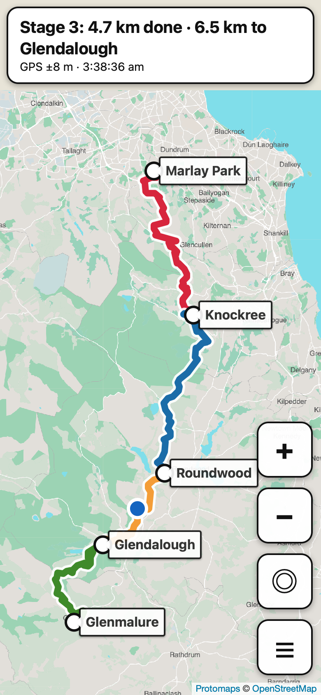

# Wicklow Way stages 1–4 — offline PWA

A deliberately small, offline-first map for walking the
[Wicklow Way](https://en.wikipedia.org/wiki/Wicklow_Way) stages 1–4
(Marlay Park → Knockree → Roundwood → Glendalough → Glenmalure).

Built after <https://wicklowtrails.ie> kept losing my place, crashing offline
with `ReferenceError: Can't find variable: matchPrecache`, and capping zoom.
The full analysis and every step are in [WORK_LOG.md](WORK_LOG.md).



## What it does

- **One continuous map** of stages 1–4, each stage a different colour, with
  stage ends labelled. Pan anywhere in the area; no edges at a stage boundary.
- **Works with no signal.** The app shell is precached by a cache-first
  service worker; the basemap is a 23 MB vector file stored on the phone.
- **Zoom as far as you like** (to level 21) and it stays sharp, because the map
  is drawn from vectors, not blurry enlarged images.
- **Never forgets where you were.** Centre, zoom, follow mode, last GPS fix and
  your walked trail are saved on every move and restored *first* on launch.
- **GPS**: blue dot, accuracy circle, "Stage 3: 4.7 km done · 6.5 km to
  Glendalough", warning when you're more than 60 m off route, purple dotted
  trail of where you've walked.
- Big buttons, thick route line, optional extra-large text and keep-screen-on.
- A **GPX of stages 1–4** (menu → Download GPX) to load into Garmin Earthmate,
  Organic Maps or OsmAnd as a backup.
- No accounts, no registration, no analytics, no network calls after install.

## Using it on the phone

1. Open the hosted URL on **wifi** (HTTPS is needed for GPS).
2. **Install it first**: iPhone Safari → Share → *Add to Home Screen*;
   Android Chrome → *Install app*.
3. **Open it from the home-screen icon**, still on wifi, and wait for the
   "✅ Offline map saved on this device" message. On iPhone the home-screen
   app has its own storage, separate from Safari, so the map must be
   downloaded *inside* the installed app.
4. Allow location access.
5. Test it: turn on Airplane mode, swipe the app away, reopen it. It should
   come back at the same place and zoom.

Controls: **+ / −** zoom (around you when following), **◎** follow me (just
pans, keeps your zoom; dragging the map turns it off), **☰** jump to a stage,
settings.

## Build and run

```sh
npm install            # only needed for the smoke test (Playwright)
npm run route          # OSM relation 2740 → public/data/route.geojson + .gpx
npm run tiles          # Protomaps extract → public/data/wicklow.pmtiles (23 MB)
npm run icons          # public/icons/*.png
npm run serve          # http://localhost:8000
npm run smoke          # end-to-end check (also: BROWSER=webkit npm run smoke)
scripts/deploy-docs.sh # copy to ../../docs/wicklow for GitHub Pages
```

`route.geojson` and `wicklow.pmtiles` are committed so the app can be
deployed without rebuilding.

## How it's built

| Piece | Choice |
|---|---|
| Map | [Leaflet 1.9.4](https://leafletjs.com) + [protomaps-leaflet 5.1.0](https://github.com/protomaps/protomaps-leaflet), vendored in `public/lib/` |
| Basemap | [Protomaps](https://protomaps.com) daily OSM build, cut to the bbox `-6.50,52.90,-6.08,53.32` at z0–15 with [`pmtiles extract`](https://github.com/protomaps/go-pmtiles); overzoomed beyond 15 |
| Offline basemap | downloaded once with a progress bar into Cache Storage, then read as a `Blob` via `pmtiles.FileSource`, so no HTTP range requests are needed offline |
| Route | OpenStreetMap relation [2740](https://www.openstreetmap.org/relation/2740), stitched in member order and split at the stage ends |
| Service worker | hand-written, ~60 lines, cache-first, navigation falls back to the cached `index.html` |
| State | one `localStorage` key `ww-state-v1` |

Stage lengths from the OSM line: 19.2, 19.5, 11.2 and 14.0 km (63.9 km in
total). Published guides differ by a km or two, because each starts and ends
the stages at slightly different points.

## Limitations

- No contour lines or hill shading. The Protomaps basemap is roads, paths,
  water, woods and place names only.
- Stage boundaries may not exactly match wicklowtrails.ie's. Adjust `PLACES`
  in `scripts/build-route.mjs`.
- When you change shell files, bump `VERSION` in `public/sw.js` so phones pick
  up the update.

Map data © [OpenStreetMap](https://www.openstreetmap.org/copyright)
contributors (ODbL).
